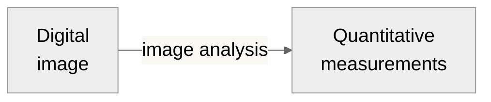
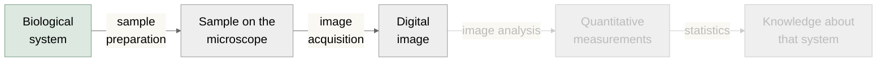

# Digital Images

The input

---

# Digital images are structured samples of a system

<!-- Red box always visible (no v-click). Position is in slide pixels;
     move it if the diagram changes. -->

<!-- https://bioart.niaid.nih.gov/bioart/677 -->

<Arrow x1="150" y1="265" x2="238" y2="265" />
<!-- https://bioart.niaid.nih.gov/bioart/675 -->

<Arrow x1="290" y1="285" x2="290" y2="375" />
<!-- https://bioart.niaid.nih.gov/bioart/503 -->

<Arrow x1="350" y1="445" x2="420" y2="445" />
<!-- https://bioart.niaid.nih.gov/bioart/240 -->

---

# Digital images are structured samples of a system

<BlockArrow dir="down" x="160" y="355" w="40" h="64" color="#FF0000" rotate="39.1212" />

<BlockArrow dir="down" x="815" y="218" w="40" h="64" color="#FF0000" rotate="39.1212" />

---

# These samples can be stored in different ways

- 8-bit = 256 levels
- 12-bit = 4096 levels
- 16-bit = 65536 levels
- 32-bit = decimal values!

**[ImageJ User Guide: Types and Formats](https://imagej.net/docs/guide/146-7.html)**

---

# These samples can be stored in different ways

*Adapted from:* <https://gregbenzphotography.com/photography-tips/8-vs-16-bit-depth-photoshop/>

- Tradeoff: Disk space vs. resolution
- Screen resolution tops out around 8-10 bits

---

# **Metadata** organizes your samples

- Dimension ordering

<v-click>

- Dimensions labels

</v-click>
<v-click>

- Pixel size, voxel size, time intervals

</v-click>
<v-click>

- ...and many, many more attributes...

</v-click>
<v-click>

- File types (.tif, .png, .asc, .nd2) signal the schema
  - use OME if you can!

</v-click>

<!-- Graphic 1: dimension ordering — visible initially, hides at click 1 -->

  
XY order

  
column-major · scans <strong>↓</strong> then →

  

    
0

    
3

    
6

    
9

    
1

    
4

    
7

    
10

    
2

    
5

    
8

    
11

  

  
← x (col) →

  
YX order

  
row-major · scans <strong>→</strong> then ↓

  

    
0

    
1

    
2

    
3

    
4

    
5

    
6

    
7

    
8

    
9

    
10

    
11

  

  
← x (col) →

cell number = byte position · lighter = stored first

<!-- Graphic 2: dimension types — z-stack, time series, multichannel (vertical) -->

  <!-- Z-stack: 4 blue planes -->
  

    

      

        
z=3

      

      

      

      

        
z=0

        
XY

      

    

    
Z-stack &nbsp;XYZ

  

  <!-- Multichannel: TRITC (amber), FITC (yellow-green), DAPI (blue) -->
  

    

      

        
TRITC

      

      

        
FITC

      

      

        
DAPI

        
XY

      

    

    
Multichannel &nbsp;XYC

  

  <!-- Time + Multichannel: 2 time points × 3 channels, 5px intra-group offset, 18px inter-group gap -->
  

    

      <!-- t=1 group (back) -->
      

      

      

        
t=1

      

      <!-- t=0 group (front), 18px gap from t=1 -->
      

      

      

        
t=0

        
XY

      

    

    
Time + Multichannel &nbsp;XYCT

  

<!-- Graphic 3: Fiji Image Properties dialog -->

Image → Properties

<!-- Graphic 4: OME logo below text on click 3 -->

---

# Quality In → Quality Out

- A clean image is the first step to successful analysis
- Common artifacts include:
  - Scratches
  - Debris
  - Poor Staining
  - Uneven Illumination
  - Spectral Crosstalk/Bleed-Through
  - Improper Stitching
  - Focus Drift
  - Saturated Signal
  - Inconsistent Parameters

<BlockArrow dir="right" x="187" y="290" w="340" h="17" color="#FF0000" />

*Mouse, retrosplenial cortex, 10x, Nikon A1R confocal*

*Noelle Cataldo*

<https://journals.plos.org/plosbiology/article?id=10.1371/journal.pbio.3002167>

<!--
Reference Kevin’s paper about good data in and good data out : https://journals.plos.org/plosbiology/article?id=10.1371/journal.pbio.3002167
-->

---
class: fiji-slide
---

# Opening images in Fiji

- Drag and drop
- `File → Open…`
- Bio-Formats supports **many** proprietary file formats
  - `.nd2` for Nikon
  - `.czi` for Zeiss
  - `.sld` for 3i
  - ...

<!-- TODO Consider replacing with a GIF, maybe opening https://zenodo.org/records/5277605-->
<!-- TODO Highlight Virtual Stacks -->

---
class: fiji-slide
---

# Visualizing your data

- 2D is an image
- 3D has a slider
- (4+)D "Hyperstacks" have multiple sliders
- `File → Open Samples` for examples of each!

**2D**

**3D**

**Hyperstack**

<!--
Z stack → Series of images taken at different focal planes along the depth of a sample
Talk about max intensity projection
-->

---
class: fiji-slide
---

# There are multiple ways to look at 3D data: *Orthogonal and 3D*

Z Stack

Orthogonal View

`Image → Stacks → Orthogonal Views`

3D View

`Plugins → 3D Viewer`

---
class: fiji-slide
---

# Look up tables (LUT) **map** pixel values color assignments

<!-- TODO: Show some use cases? e.g. when glasbey is useful-->
- Does **not** change the data in the image
  - "1 is red, 2 is blue, ..."
- LUT **can** change user perceptions
  - Color-blindness
- Fiji offers calibration bars
- *Use `glasbey` for label images*
- *Use `HiLo` during acquisition*
  - Just dark vs. no signal
  - Just bright vs. saturated

---
class: fiji-slide
---

# Add a scale bar for publication images

`Analyze → Tools → Scale Bar`

*Mouse, hippocampus, 10x, Nikon A1R confocal*

*Noelle Cataldo*

<!--
Come much earlier
-->

