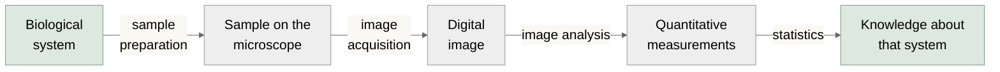

# About Me!

- Eliceiri Lab since 2017
- Based in Chicago, IL
- Core developer for Fiji and Micro-Manager

---

# Outline

- The Bioimaging Pipeline
- Fiji Overview
- Digital Images
  - Fundamentals
  - Visualization
- Quantitative Measurements
- Image Analysis
  - Segmentation
  - Preprocessing
  - Measurements
    - Segment Analysis
    - Tracking
    - Colocalization
- Scripting
<!-- LLMs in Fiji -->

---

# The Bioimaging Pipeline

<!-- Red box around "Digital image -> image analysis -> Quantitative
     measurements", shown on the first click. Position is in slide pixels;
     move it if the diagram changes. -->

<v-click> This lecture seeks to describe: </v-click>

<v-clicks>

- **Inputs:** digital images
- **Outputs:** quantitative measurements
- **Functions:** image analysis pipelines

</v-clicks>

<v-click>This lecture focuses on Fiji/ImageJ...</v-click>

<v-click>but there are many great alternatives!</v-click>

<!-- Fiji / ImageJ — revealed on click 6; red border highlights the focus area -->

**Fiji**

**ImageJ**

<!-- Alternatives — revealed on click 7 -->

**QuPath**

**Imaris**

**Cellprofiler**

