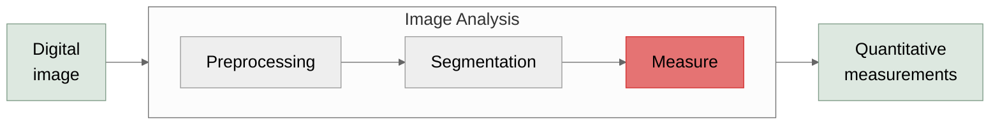

# Measurement & Feature Analysis
Measuring properties of segmented objects

---

# What questions can be answered, *revisited*?

  

    

      <CountGraphic :scale="0.7" />
      

        <CountGraphic :scale="0.35" segmented />
      

    

    How <b>many</b> X are there?
  

  

    

      <ShapeGraphic :scale="0.7" />
      

        <ShapeGraphic :scale="0.35" segmented />
      

    

    What <b>shape/size</b> is X?
  

  

    

      <IntensityGraphic :scale="0.7" />
      

        <IntensityGraphic :scale="0.35" segmented />
      

    

    How <b>bright</b> is X?
  

  

    

      <MotionGraphic :scale="0.7" />
      

        <MotionGraphic :scale="0.35" segmented />
      

    

    Does X <b>move</b>?
  

  

    

      <ColocGraphic :scale="0.7" />
      

        <ColocGraphic :scale="0.35" segmented />
      

    

    Does X appear <b>near</b> Y?
  

---
class: fiji-slide
---

# Fiji's `Analyze Particles`

  

    <ShapeGraphic :scale="0.5" />
    

      <ShapeGraphic :scale="0.25" segmented />
    

  

- `Analyze → Analyze Particles`
  - Requires a **binary 8-bit** image
- `Size`/`Circularity` filter particles
- `Show` tailors particle visualization
- `Clear Results` removes previous measurements
  - Untoggle when analyzing multiple images

<LinkButton left="530" top="502" width="419" height="32" href="https://imagej.net/imaging/particle-analysis" icon="🔬" label="Particle Analysis - ImageJ Wiki" />

---
class: fiji-slide
---

# Selecting measurements

  

    <ShapeGraphic :scale="0.5" />
    

      <ShapeGraphic :scale="0.25" segmented />
    

  

`Analyze → Set Measurements…`
  - **Area:** Pixels in the segment
  - **Shape Descriptors:** Circularity, etc.
  - **Mean Gray Value:** Integrated density divided by the number of pixels
  - *many* more options
  - **Redirect to:** The target for statistical calculations
    - If `None`, `Mean` will be `255`!

<LinkButton left="36" top="502" width="580" height="32" href="https://imagej.net/ij/docs/menus/analyze.html" icon="📖" label="Analyze Menu - ImageJ Docs" />

---
class: fiji-slide
---

# Fiji's `Analyze Particles`

  

    <ShapeGraphic :scale="0.5" />
    

      <ShapeGraphic :scale="0.25" segmented />
    

  

Segmented image

<code>Analyze → Set Measurements</code> (if necessary)

<code>Analyze → Analyze Particles</code>

Objects detected and measured

<svg class="abs" style="left:0; top:0; width:980px; height:551px; pointer-events:none" viewBox="0 0 980 551" xmlns="http://www.w3.org/2000/svg">
  <defs>
    <marker id="arr-meas" markerWidth="8" markerHeight="6" refX="7" refY="3" orient="auto">
      <polygon points="0,0 8,3 0,6" fill="#333"/>
    </marker>
  </defs>
  <g v-click="1">
    <path d="M 205 300 H 232" stroke="#333" stroke-width="1.5" fill="none" marker-end="url(#arr-meas)"/>
  </g>
  <g v-click="2">
    <path d="M 390 300 H 412" stroke="#333" stroke-width="1.5" fill="none" marker-end="url(#arr-meas)"/>
  </g>
  <g v-click="3">
    <path d="M 540 300 H 562" stroke="#333" stroke-width="1.5" fill="none" marker-end="url(#arr-meas)"/>
  </g>
</svg>

  Save results as CSV: <strong>File → Save As...</strong>

---
class: fiji-slide
---

# TrackMate for particle tracking

  

    <MotionGraphic :scale="0.5" />
    

      <MotionGraphic :scale="0.25" segmented />
    

  

- `Plugins → Tracking → TrackMate`
  - Comes with Fiji!
- Multiple tracking algorithms available
- Step-by-step instructions
- Handles:
  - Segmentation (integrated)
  - Linking tracks/object jumps across frames
  - Cell fates
  - Recognizing splitting and merging objects

---

# Colocalization

  

    <ColocGraphic :scale="0.5" />
    

      <ColocGraphic :scale="0.25" segmented />
    

  

- Computational approach to quantify label co-occurrence
- Suggests physical proximity or co-expression
- **Pixel-based:** Pearson's / Manders' correlation coefficients
- **Object-based:** fraction of objects that overlap with a counterpart channel
- *Quite the rabbit hole...*

Adapted from Wang. et al (2019)

---
class: fiji-slide
---

# Colocalization in Fiji: `Coloc2`

  

    <ColocGraphic :scale="0.5" />
    

      <ColocGraphic :scale="0.25" segmented />
    

  

- `Analyze → Colocalization → Coloc 2`
  - Comes with Fiji!
- Allows a ROI or a binary pixel mask
- Supports Li, Manders', Kendall's, Spearman's Colocalization Coefficients

<LinkButton left="50" top="502" width="419" height="32" href="https://imagej.net/plugins/coloc-2" icon="🔬" label="Coloc 2 - ImageJ Wiki" />

