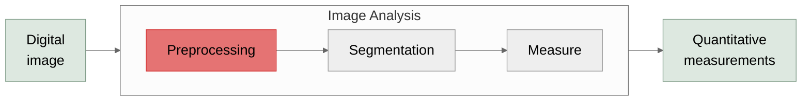

# Preprocessing

readying your data for segmentation

---

# Sometimes your objects don't fit in the FOV

- Imaging large samples at high resolution requires a tiled scan
  - Will not fit in single field of view

---
class: fiji-slide
---

# Stitching in Fiji

- Create one large image from many tiles
- `Plugins → Stitching → Grid/Collection stitching`
- `Positions from file` option uses image metadata
  - Other options compute tile positions given parameters

---
hide: true
---

# How do I stitch tiled images with the Grid/Collection Stitching plugin?

- Plugins → Stitching → Grid/Collection Stitching
- Select the Type and Order based on how images were collected/labeled
- Input necessary parameters including:
  - Grid Size
  - Overlap
  - First file index i → Are your tiles labeled in order 1, 2, 3, etc
  - File names for tiles → \[name\]-{i} where i is the file index
  - Unselect compute overlap

<Line x1="658" y1="182" x2="706" y2="182" color="#FF0000" width="5" arrow="end" />

<Line x1="778" y1="182" x2="826" y2="182" color="#FF0000" width="5" arrow="end" />

<Line x1="654" y1="319" x2="703" y2="319" color="#FF0000" width="5" arrow="end" />

<Line x1="778" y1="319" x2="826" y2="319" color="#FF0000" width="5" arrow="end" />

<Line x1="654" y1="451" x2="703" y2="451" color="#FF0000" width="5" arrow="end" />

<Line x1="779" y1="451" x2="828" y2="451" color="#FF0000" width="5" arrow="end" />

<Line x1="820" y1="224" x2="654" y2="277" color="#FF0000" width="5" arrow="end" />

<Line x1="820" y1="369" x2="662" y2="409" color="#FF0000" width="5" arrow="end" />

---

# Image histograms aid image analysis

- Describes distribution of pixel intensities in your image
- Segmentation separates foreground (**signal**) from background (**noise**)
  - *harder when they overlap in the histogram*
- Compressed/cutoff histograms mean low contrast
  - *Post-hoc contrast adjustment is a workaround*

---
class: fiji-slide
---

# Adjust Brightness/Contrast in Fiji

- `Process → Adjust → Brightness/Contrast`
- Good way to visualize data without changing the pixel values
- Linear transformation!
  - **If "Apply" is selected pixel values will change**

<BlockArrow dir="right" x="651" y="180" w="116" h="29" color="#FF0000" />

<BlockArrow dir="right" x="658" y="448" w="116" h="29" color="#FF0000" />

---
class: fiji-slide
---

# Contrast-Limited Adaptive Histogram Equalization

- `Process → Enhance Local Contrast (CLAHE)`
- Enhances contrast **locally**
  - **non-linear**
  - Good for uneven illumination
  - Handles near-constant regions nicely
<!-- TODO: Some graphical illustrations of these concepts might be nice-->
- Parameters
  - `Block Size` → Defines region around a pixel where histogram is equalized
  - `Histogram Bins` → Number of bins used for equalization
  - `Max Slope` → Large values = maximum local contrast whereas 1 = original image

<BlockArrow dir="right" x="690" y="484" w="116" h="29" color="#FF0000" />

<LinkButton left="613" top="114" width="271" height="31" href="https://imagej.net/plugins/clahe" icon="🔧" label="Plugin Documentation" />

<!--
If you don’t know what the input parameters mean, play around until you figure out what works for your data.
-->

---

# What can we do when data is noisy?

<!-- TODO: Add in nuclei1-->

<!-- TODO: Make a script to recreate -->

Data info:

- Widefield fluorescence, 20x/0.75NA
- Voxel dimensions: 0.124x0.124x0.200 um
- Emission peak wavelength: 500 nm

Source:

- Simulated data from the Light Microscopy Research Group (LMRG) Image Analysis Study

---

# Mean filter multiplication suppresses noise

***Mean filter***: computes *local* average, *suppressing noise*
 

***Multiply***:
- nuclei (bright × high mean) amplified
- noise spikes (bright × low mean) suppressed.
 

***Net effect***: pushes the two populations further apart in intensity.

Without mean multiplication

With mean multiplication

---
class: fiji-slide
---

# Mean filter multiplication in Fiji

Input image

Mean filter (<code>radius=5</code>)

Multiply

Otsu threshold

<svg class="abs" style="left:0; top:0; width:980px; height:551px; pointer-events:none" viewBox="0 0 980 551" xmlns="http://www.w3.org/2000/svg">
  <defs>
    <marker id="arr-mean" markerWidth="8" markerHeight="6" refX="7" refY="3" orient="auto">
      <polygon points="0,0 8,3 0,6" fill="#333"/>
    </marker>
  </defs>
  <g v-click="1">
    <path d="M 112 355 V 402 Q 112 417 127 417 H 220" stroke="#333" stroke-width="1.5" fill="none" marker-end="url(#arr-mean)"/>
  </g>
  <g v-click="2">
    <!-- branch from input image right-center -->
    <path d="M 215 207 H 420" stroke="#333" stroke-width="1.5" fill="none"/>
    <!-- branch from mean filter top-center, curves up then right to junction -->
    <path d="M 317 295 V 220 Q 317 207 332 207 H 420" stroke="#333" stroke-width="1.5" fill="none"/>
    <!-- merged arrow into multiply image -->
    <path d="M 420 207 H 430" stroke="#333" stroke-width="1.5" fill="none" marker-end="url(#arr-mean)"/>
  </g>
  <g v-click="3">
    <path d="M 527 355 V 402 Q 527 417 542 417 H 640" stroke="#333" stroke-width="1.5" fill="none" marker-end="url(#arr-mean)"/>
  </g>
</svg>

---
class: fiji-slide
---

# Background subtraction improved thresholding

**nuclei 2**

**nuclei 2**

---
class: fiji-slide
---

# Aside: Image Math in Fiji

- `Process → Image Calculator...`

Binary operations:
- Add, Subtract, Divide, Multiply
- AND, OR, XOR
  - *AND* helps find overlapping particles
- Min, Max, Average
- Difference: `|image1 - image2|`
- Copy: `image1 = image2`
- Transparent-Zero: `image1` is transparent where `image2 = 0`

Don't overwrite your data!

<Line x1="220" y1="480" x2="220" y2="410" color="#CC0000" width="2" arrow="end" />

---
<!-- TODO: Ask Ed about this slide-->
hide: true
---

# Surface plots are a good way to visualize this change in pixel value: *Before*

*Nuclei 1 crop surface plot*

*Nuclei 2 crop surface plot*

- Surface plot → 3D visualization tool that maps intensities of a 2D image
  - Creates a topographic map
- Analyze → Surface Plot…

---
hide: true
---

# Surface plots are a good way to visualize this change in pixel value: *After*

*Nuclei 1 crop surface plot*

*Nuclei 2 crop surface plot*

- Decreased background shown by bottom of slope (left)
- Greater range of values

---

# What if the background is non-uniform?

- 100x confocal microscopy.
- 3D data (X, Y, Channel).
- Must deal with large hazy structures (*i.e.* nuclear shadow).
- Must preserve puncta.

<Line v-click.hide="1" x1="492" y1="349" x2="250" y2="372" color="#91DAED" width="2" />

<Line v-click.hide="1" x1="251" y1="421" x2="493" y2="524" color="#91DAED" width="2" />

Classical threshold

Data from Sofia Romero

<!--
High pass filter → Keep highest pixel values ("outliers")
-->

---

# Gaussian blur subtractsions extract puncta signal from the background

**Input**

**Gaussian blur (σ = 5)**

**blur - input**

Data from Sofia Romero

- Small gaussian filters (σ = \~ 2) suppress noise.
- Larger gaussian filters (σ = \~ &gt;5) suppress large structures.

<!--
Blur the image where the structures you are trying to keep are not visible-- retains the strucutes you don't want (haze).

Difference of gaussian captures features inside of feature valley, but doesn't always work.

Can remove small noise with small gaussian or large gauissina...
-->

---
class: fiji-slide
---

# Gaussian subtraction in Fiji

Input image

Gaussian blur <code>Filters → Gaussian Blur</code>

Subtract blur − input <code>Image Calculator</code>

Apply threshold <code>Ctrl+Shift+T</code>

Result overlay

  
  
Original threshold

<svg class="abs" style="left:0; top:0; width:980px; height:551px; pointer-events:none" viewBox="0 0 980 551" xmlns="http://www.w3.org/2000/svg">
  <defs>
    <marker id="arr-gauss" markerWidth="8" markerHeight="6" refX="7" refY="3" orient="auto">
      <polygon points="0,0 8,3 0,6" fill="#333"/>
    </marker>
  </defs>
  <g v-click="1">
    <path d="M 97 256 V 398 Q 97 413 112 413 H 183" stroke="#333" stroke-width="1.5" fill="none" marker-end="url(#arr-gauss)"/>
  </g>
  <g v-click="2">
    <!-- branch from input image right-center -->
    <path d="M 185 183 H 340" stroke="#333" stroke-width="1.5" fill="none"/>
    <!-- branch from Gaussian blur top-center, curves up then right to junction -->
    <path d="M 265 335 V 196 Q 265 183 280 183 H 340" stroke="#333" stroke-width="1.5" fill="none"/>
    <!-- merged arrow into subtraction image -->
    <path d="M 340 183 H 350" stroke="#333" stroke-width="1.5" fill="none" marker-end="url(#arr-gauss)"/>
  </g>
  <g v-click="3">
    <path d="M 432 256 V 398 Q 432 413 447 413 H 518" stroke="#333" stroke-width="1.5" fill="none" marker-end="url(#arr-gauss)"/>
  </g>
  <g v-click="4">
    <path d="M 600 335 V 196 Q 600 183 615 183 H 685" stroke="#333" stroke-width="1.5" fill="none" marker-end="url(#arr-gauss)"/>
  </g>
</svg>

Data from Sofia Romero

---
hide: true
---

# Interested in performing this function? Use the script!

**<https://github.com/elevans/fiji-scripts/>**

---

# Deconvolution "undoes" diffraction blur

**Output**

**Input**

- Out of focus light leads to loss of contrast
  - Deconvolution models the *point spread function* to recover ground truth
- *Why use deconvolution?*
  - Improves clarity
  - Aids in segmentation
- Multiple types of deconvolution exist
  - Weiner
  - Richardson-Lucy

<LinkButton left="42" top="493" width="354" height="30" href="https://imagej.net/imaging/deconvolution" icon="🔬" label="Deconvolution - ImageJ Wiki" />

*Adapted from Scientific Volume Imaging (SVI) and Codicals*

---

# … using the point spread function

- **Point Spread Function (PSF)**: Point source of light as imaged through a lens or series of lenses
  - Captures optical diffraction, abberations
- PSFs can be:
  - **Measured** – Obtained by imaging sub-resolution sized beads
    - Averaging can suppress noise
  - **Theoretical (Synthetic)** – Generated by a computer based on parameters
    - Simulated with simple Gaussian kernels or more complex models

**Simulated PSF**

**Real PSF**

**XY**

**XZ**

---

<!-- TODO: Get a slide showing this in Fiji -->
# Richardson-Lucy Total Variation Deconvolution

- Richardson-Lucy Total Variation (TV) → Iterative algorithm for recovering the underling image from a blurred dataset using a PSF
- Original Richardsen-Lucy amplifies noise after a small number of iterations
- Richardson-Lucy TV avoids this noise accumulation leading to better image recovery and object edges

**Input**

**Blurred input**

**Richardson-**

**Lucy**

**Richardson-Lucy TV**

Adapted from Dey *et al*. Microscopy Research and Technique (2006)

