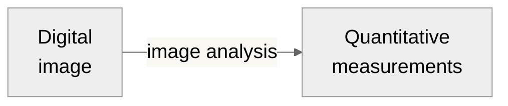
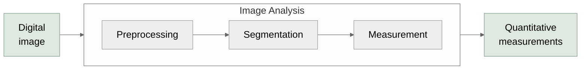

# Quantitative Measurements

The output

---

# What questions can be answered with quantitative measurements?

<!-- TODO a grid here could be nice -->

- How many X are there?

<v-click>

- What shape/size is X?

</v-click>
<v-click>

- How bright is X?

</v-click>
<v-click>

- Does X move?

</v-click>
<v-click>

- Does X appear near Y?

</v-click>
<v-click>

*...but how can we get from images to measurements?*

</v-click>

  <CountGraphic />

  <ShapeGraphic />

  <IntensityGraphic />

  <MotionGraphic />

  <ColocGraphic />

---

# Image Analysis, *simplified*

<Line v-click="1" x1="320" y1="375" x2="350" y2="270" color="#e57373" width="2" arrow="end" />

  Making it easy to spot objects of interest

<Line v-click="2" x1="490" y1="455" x2="490" y2="270" color="#e57373" width="2" arrow="end" />

  Identifying where objects are

<Line v-click="3" x1="660" y1="375" x2="640" y2="270" color="#e57373" width="2" arrow="end" />

  Quantifying properties of each object

