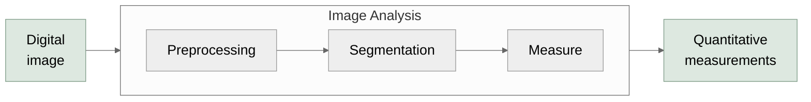
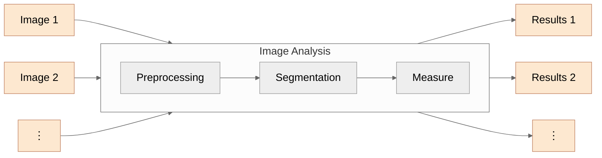

# Scripting

---

# Scripting facilitates *replication*

- Experiments contain many datasets
- Experiments are often repeated, iterated on
- Processes must (should) be published for replication
  - The **R** in [**FAIR science**](https://doi.org/10.1038/sdata.2016.18)

---
class: fiji-slide
---

# Scripting in Fiji

`File → New → Script...`

**Supported Languages:**  
- Groovy
- Python
- *ImageJ Macro*,
- ...

<LinkButton left="14" top="490" width="430" height="36" href="https://imagej.net/scripting/script-editor" icon="📖" label="Script Editor - ImageJ Wiki" />

---
class: fiji-slide
---

# Scripting in Fiji: **Macros**

- Less powerful
- Older (predates Fiji)
- Easy to learn, *record*, and use

<LinkButton left="105" top="479" width="333" height="50" href="https://imagej.net/scripting/macro#the-recorder" icon="⏺" label="ImageJ Macro Recorder" />
<LinkButton left="568" top="479" width="359" height="50" href="https://imagej.net/ij/developer/macro/functions.html" icon="📋" label="Built-in Macro Functions" />

---
class: fiji-slide
---

# Writing a macro

- Open an image
- `Plugins → Macros → Record...`
- run your workflow
- `Create`
  - Export to **Script Editor**
- `Run`
  - Uses the active image
- `File → Save As...`
  - Saves as a *SciJava Script*

<LinkButton left="350" top="490" width="600" height="36" href="https://imagej.net/scripting/macro#the-recorder" icon="📖" label="imagej.net/scripting/macro#the-recorder" />

---

# Other applications handle replication differently

