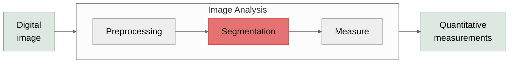

# Segmentation

Finding the objects

---

# Segmentation answers "where are my objects?"

- Derives pixel labels or object boundaries against an image
- Generally based on pixel intensity

---
class: fiji-slide
---

# Classical segmentation in Fiji

Input image

<code>Ctrl+Shift+T</code> to threshold

**Threshold Strategy** — Otsu is a nice option!

**Dark background** — Select if your objects are bright

**Stack histogram** — Select for a timelapse / z-stack

Click <code>Apply</code> to threshold

<svg class="abs" style="left:0; top:0; width:980px; height:551px; pointer-events:none" viewBox="0 0 980 551" xmlns="http://www.w3.org/2000/svg">
  <defs>
    <marker id="arr8" markerWidth="8" markerHeight="6" refX="7" refY="3" orient="auto">
      <polygon points="0,0 8,3 0,6" fill="#333"/>
    </marker>
  </defs>
  <g v-click="1">
    <path d="M 185 364 H 260" stroke="#333" stroke-width="1.5" fill="none" marker-end="url(#arr8)"/>
  </g>
  <g v-click="2">
    <!-- Threshold strategy highlight -->
    <rect x="472" y="409" width="69" height="14" fill="rgba(255,152,0,0.1)" stroke="rgba(255,152,0,0.9)" stroke-width="1.5" rx="2"/>
  </g>
  <g v-click="3">
    <!-- Dark background highlight -->
    <rect x="466" y="426" width="69" height="14" fill="rgba(76,175,80,0.1)" stroke="rgba(76,175,80,0.9)" stroke-width="1.5" rx="2"/>
  </g>
  <g v-click="4">
    <!-- Stack histogram highlight -->
    <rect x="535" y="426" width="71" height="14" fill="rgba(156,39,176,0.1)" stroke="rgba(156,39,176,0.9)" stroke-width="1.5" rx="2"/>
  </g>
  <g v-click="5">
    <path d="M 628 414 Q 665 414 750 364" stroke="#333" stroke-width="1.5" fill="none" marker-end="url(#arr8)"/>
  </g>
</svg>

---
class: fiji-slide
---

# Labkit: a GUI approach to segmentation

- `Plugins → Labkit → Open Current Image With Labkit`
- Manually draw on image to indicate foreground and background
- Export to Fiji or save to TIFF/HDF5 when done

<BlockArrow dir="right" x="593" y="232" w="69" h="58" color="#96DCF8" rotate="45.224" />

<BlockArrow dir="right" x="750" y="316" w="69" h="58" color="#96DCF8" rotate="45.224" />

---
class: fiji-slide
---

# StarDist: Segmentation via Deep Learning

- Segments cells using deep learning which can be done with pretrained models
- Broad platform support via `cellcast`
  - `File → New → Script...`
  - `Templates → Appose → Stardist cellcast (Python (Appose))`
  - `Run` button runs on the active image

---

# Classical vs ML Segmentation

**Classical** (thresholding, watershed)

✅ No training data needed
 
✅ Fast to set up and easy to debug
 
✅ Interpretable, explicit parameters
 

<Line x1="490" y1="90" x2="490" y2="210" color="#aaaaaa" width="2" />

**ML-based** (StarDist, Cellpose, …)

✅ Robust to intensity and background variation
 
✅ Handles touching and irregular shapes
 
✅ Generalizes to new conditions
 

Otsu Threshold

StarDist Segmentation

<!-- Gaussian blur of sigma=20, then subtracted from the original-->

<em>Gaussian Highpass</em> + Otsu Threshold

