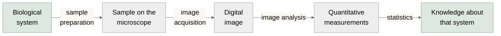
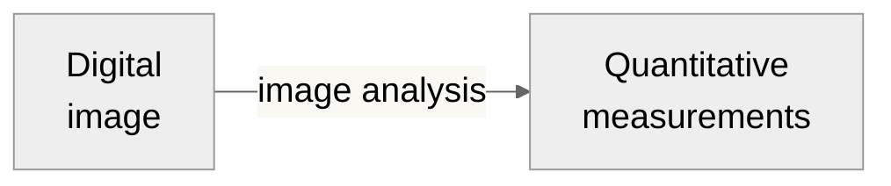
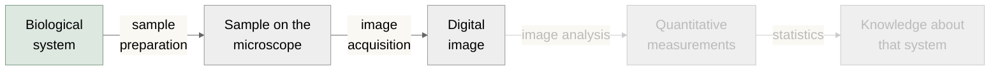
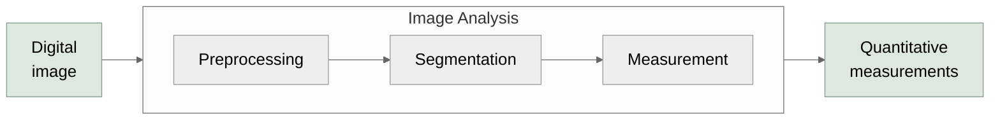
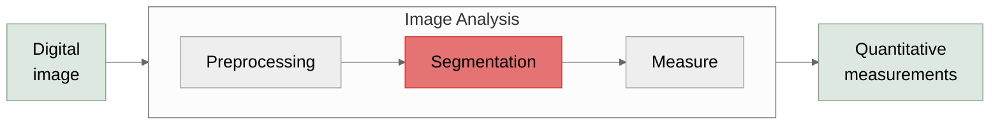
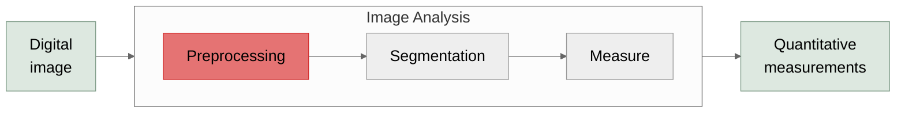
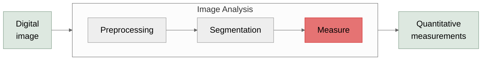
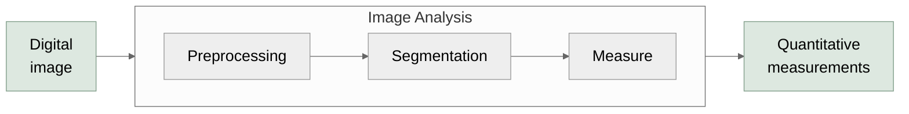
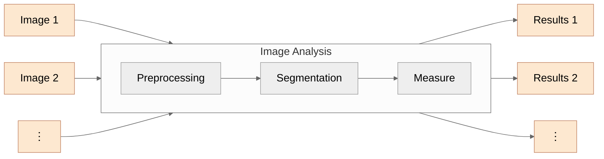

# Image Analysis with Fiji/ImageJ

Gabriel Selzer

Research Software Engineer

Kevin Eliceiri Lab

University of Wisconsin-Madison / Morgridge Institute for Research

*Adapted from the work of Noelle Cataldo, Helen Wilson, Bjorn Paulson, Edward Evans, and more.*

---

# About Me!

- Eliceiri Lab since 2017
- Based in Chicago, IL
- Core developer for Fiji and Micro-Manager

---

# Outline

- The Bioimaging Pipeline
- Fiji Overview
- Digital Images
  - Fundamentals
  - Visualization
- Quantitative Measurements
- Image Analysis
  - Segmentation
  - Preprocessing
  - Measurements
    - Segment Analysis
    - Tracking
    - Colocalization
- Scripting
<!-- LLMs in Fiji -->

---

# The Bioimaging Pipeline

<!-- Red box around "Digital image -> image analysis -> Quantitative
     measurements", shown on the first click. Position is in slide pixels;
     move it if the diagram changes. -->

<v-click> This lecture seeks to describe: </v-click>

<v-clicks>

- **Inputs:** digital images
- **Outputs:** quantitative measurements
- **Functions:** image analysis pipelines

</v-clicks>

<v-click>This lecture focuses on Fiji/ImageJ...</v-click>

<v-click>but there are many great alternatives!</v-click>

<!-- Fiji / ImageJ — revealed on click 6; red border highlights the focus area -->

**Fiji**

**ImageJ**

<!-- Alternatives — revealed on click 7 -->

**QuPath**

**Imaris**

**Cellprofiler**

---
class: fiji-slide
---

# <u>**F**</u>iji <u>**I**</u>s <u>**J**</u>ust <u>**I**</u>mageJ

- **ImageJ 1.x**: image analysis since 1997
- **ImageJ2**: a rewrite for modularity and generality
- **Fiji**: ImageJ + ImageJ2 + popular plugins

Curtis Rueden

Wayne Rasband

<LinkButton left="32" top="462" width="369" href="https://imagej.net/Fiji" icon="⬇️" label="Download Fiji here!" />

---
class: fiji-slide
---

# Fiji Interface

<!-- Both images on right side; highlights declared after so they render on top -->

<!-- Click 1: Menu bar highlight -->

**Menu bar** — File, Edit, Image, Process, Analyze, Plugins, Window, Help

<!-- Click 2: Toolbar highlight -->

**Toolbar** — Selection, drawing, and measurement tools

💡 Right-click a tool for shape variants

💡 Double-click a tool to configure it

<!-- Click 3: Status bar highlight -->

**Status bar** — shows memory usage and pixel coordinates

💡 Click it see your Fiji version

<!-- Click 4: Search highlight (stays visible on click 5) -->

**Search** — Ctrl+L (or click the icon) to find any menu command by name

<LinkButton left="20" top="462" width="350" href="https://imagej.net/Getting_Started" icon="📖" label="Getting Started — ImageJ wiki" />

---
class: fiji-slide
hide: true <!-- TODO: What is the point of this -->
---

# Operating the interface

- Selections
- Hold shift to make vertical/horizontal lines and perfect circles
- Regions of interest → ROIs
  - Can be added to ROI manager and saved

<video class="abs" src="/media/s19-screen-recording-2026-02-23-at-1-12-12-p.mov" poster="/media/s19-screen-recording-2026-02-23-at-1-12-12-p.png" controls style="left:24px; top:135px; width:574px; height:374px"></video>

---
class: fiji-slide
hide: true
---

# There is a search bar to easily open certain features

- Edit → Options → Search Bar
- Control + L brings up the search bar
- Or simply click the bar at the bottom left of the interface

***Tip: Find more keyboard shortcuts here*** ***<https://imagej.net/ij/docs/shortcuts.html>***

---
class: fiji-slide
---

# Fiji and all plugins can be manually updated

<BlockArrow dir="right" x="252" y="294" w="159" h="56" color="#FF0000" />

Not this one!

<BlockArrow dir="right" x="252" y="408" w="159" h="56" color="#3B7D23" />

Correct

<LinkButton left="117" top="481" width="428" height="37" href="https://imagej.net/plugins/updater" icon="🔧" />

<!--
Update ImageJ updates the actual ImageJ
Update… updates the plugins
If plugin breaks, get latest ImageJ → If doesn’t put in a request (image.sc)
-->

---
class: fiji-slide
---

# The user can indicate specific update sites

- Useful if you want to maintain a specific plugin version for an experiment already started

<LinkButton left="50" top="504" width="582" height="37" href="https://imagej.net/update-sites/following" icon="📦" />

---
class: fiji-slide
---

# Stuck? Help is available!

<LinkButton left="144" top="505" width="221" height="37" href="https://imagej.net" icon="🌐" />
<LinkButton left="577" top="505" width="305" height="37" href="https://forum.image.sc/" icon="💬" />

<!--
Can also just Google questions! Or ask ChatGPT!

***Virtual memory
-->

---
layout: section
---

# Digital Images

The input

---

# Digital images are structured samples of a system

<!-- Red box always visible (no v-click). Position is in slide pixels;
     move it if the diagram changes. -->

<!-- https://bioart.niaid.nih.gov/bioart/677 -->

<Arrow x1="150" y1="265" x2="238" y2="265" />
<!-- https://bioart.niaid.nih.gov/bioart/675 -->

<Arrow x1="290" y1="285" x2="290" y2="375" />
<!-- https://bioart.niaid.nih.gov/bioart/503 -->

<Arrow x1="350" y1="445" x2="420" y2="445" />
<!-- https://bioart.niaid.nih.gov/bioart/240 -->

---

# Digital images are structured samples of a system

<BlockArrow dir="down" x="160" y="355" w="40" h="64" color="#FF0000" rotate="39.1212" />

<BlockArrow dir="down" x="815" y="218" w="40" h="64" color="#FF0000" rotate="39.1212" />

---

# These samples can be stored in different ways

- 8-bit = 256 levels
- 12-bit = 4096 levels
- 16-bit = 65536 levels
- 32-bit = decimal values!

**[ImageJ User Guide: Types and Formats](https://imagej.net/docs/guide/146-7.html)**

---

# These samples can be stored in different ways

*Adapted from:* <https://gregbenzphotography.com/photography-tips/8-vs-16-bit-depth-photoshop/>

- Tradeoff: Disk space vs. resolution
- Screen resolution tops out around 8-10 bits

---
hide: true  <!-- TODO: What is this supposed to show? -->
---

# 3D representations can also be used to visualize bit depth

**32 bit**

**16 bit**

**8 bit**

Courtesy of Edward Evans

---

# **Metadata** organizes your samples

- Dimension ordering

<v-click>

- Dimensions labels

</v-click>
<v-click>

- Pixel size, voxel size, time intervals

</v-click>
<v-click>

- ...and many, many more attributes...

</v-click>
<v-click>

- File types (.tif, .png, .asc, .nd2) signal the schema
  - use OME if you can!

</v-click>

<!-- Graphic 1: dimension ordering — visible initially, hides at click 1 -->

  
XY order

  
column-major · scans <strong>↓</strong> then →

  

    
0

    
3

    
6

    
9

    
1

    
4

    
7

    
10

    
2

    
5

    
8

    
11

  

  
← x (col) →

  
YX order

  
row-major · scans <strong>→</strong> then ↓

  

    
0

    
1

    
2

    
3

    
4

    
5

    
6

    
7

    
8

    
9

    
10

    
11

  

  
← x (col) →

cell number = byte position · lighter = stored first

<!-- Graphic 2: dimension types — z-stack, time series, multichannel (vertical) -->

  <!-- Z-stack: 4 blue planes -->
  

    

      

        
z=3

      

      

      

      

        
z=0

        
XY

      

    

    
Z-stack &nbsp;XYZ

  

  <!-- Multichannel: TRITC (amber), FITC (yellow-green), DAPI (blue) -->
  

    

      

        
TRITC

      

      

        
FITC

      

      

        
DAPI

        
XY

      

    

    
Multichannel &nbsp;XYC

  

  <!-- Time + Multichannel: 2 time points × 3 channels, 5px intra-group offset, 18px inter-group gap -->
  

    

      <!-- t=1 group (back) -->
      

      

      

        
t=1

      

      <!-- t=0 group (front), 18px gap from t=1 -->
      

      

      

        
t=0

        
XY

      

    

    
Time + Multichannel &nbsp;XYCT

  

<!-- Graphic 3: Fiji Image Properties dialog -->

Image → Properties

<!-- Graphic 4: OME logo below text on click 3 -->

---

# Quality In → Quality Out

- A clean image is the first step to successful analysis
- Common artifacts include:
  - Scratches
  - Debris
  - Poor Staining
  - Uneven Illumination
  - Spectral Crosstalk/Bleed-Through
  - Improper Stitching
  - Focus Drift
  - Saturated Signal
  - Inconsistent Parameters

<BlockArrow dir="right" x="187" y="290" w="340" h="17" color="#FF0000" />

*Mouse, retrosplenial cortex, 10x, Nikon A1R confocal*

*Noelle Cataldo*

<https://journals.plos.org/plosbiology/article?id=10.1371/journal.pbio.3002167>

<!--
Reference Kevin’s paper about good data in and good data out : https://journals.plos.org/plosbiology/article?id=10.1371/journal.pbio.3002167
-->

---
class: fiji-slide
---

# Opening images in Fiji

- Drag and drop
- File → Open…
- Bio-Formats supports **many** proprietary file formats
  - `.nd2` for Nikon
  - `.czi` for Zeiss
  - `.sld` for 3i
  - ...

<!-- TODO Consider replacing with a GIF, maybe opening https://zenodo.org/records/5277605-->
<!-- TODO Highlight Virtual Stacks -->

---
class: fiji-slide
---

# Visualizing your data

- 2D is an image
- 3D has a slider
- (4+)D "Hyperstacks" have multiple sliders
- `File → Open Samples` for examples of each!

**2D**

**3D**

**Hyperstack**

<!--
Z stack → Series of images taken at different focal planes along the depth of a sample
Talk about max intensity projection
-->

---
class: fiji-slide
hide: true
---

# There are multiple ways to look at 3D data: *Reslice*

Z Stack

**To get a different view:**

`Image → Stacks → Reslice`

---
class: fiji-slide
---

# There are multiple ways to look at 3D data: *Orthogonal and 3D*

Z Stack

Orthogonal View

`Image → Stacks → Orthogonal Views`

3D View

`Plugins → 3D Viewer`

---
class: fiji-slide
---

# Look up tables (LUT) **map** pixel values color assignments

<!-- TODO: Show some use cases? e.g. when glasbey is useful-->
- Does **not** change the data in the image
  - "1 is red, 2 is blue, ..."
- LUT **can** change user perceptions
  - Color-blindness
- Fiji offers calibration bars
- *Use `glasbey` for label images*
- *Use `HiLo` during acquisition*
  - Just dark vs. no signal
  - Just bright vs. saturated

---
class: fiji-slide
---

# Add a scale bar for publication images

`Analyze → Tools → Scale Bar`

*Mouse, hippocampus, 10x, Nikon A1R confocal*

*Noelle Cataldo*

<!--
Come much earlier
-->

---
layout: section
---

# Quantitative Measurements

The output

---

# What questions can be answered with quantitative measurements?

<!-- TODO a grid here could be nice -->

- How many X are there?

<v-click>

- What shape/size is X?

</v-click>
<v-click>

- How bright is X?

</v-click>
<v-click>

- Does X move?

</v-click>
<v-click>

- Does X appear near Y?

</v-click>
<v-click>

*...but how can we get from images to measurements?*

</v-click>

  <CountGraphic />

  <ShapeGraphic />

  <IntensityGraphic />

  <MotionGraphic />

  <ColocGraphic />

---

# Image Analysis, *simplified*

<Line v-click="1" x1="320" y1="375" x2="350" y2="270" color="#e57373" width="2" arrow="end" />

  Making it easy to spot objects of interest

<Line v-click="2" x1="490" y1="455" x2="490" y2="270" color="#e57373" width="2" arrow="end" />

  Identifying where objects are

<Line v-click="3" x1="660" y1="375" x2="640" y2="270" color="#e57373" width="2" arrow="end" />

  Quantifying properties of each object

---
layout: section
---

# Segmentation

Finding the objects

---

# Segmentation answers "where are my objects?"

- Derives pixel labels or object boundaries against an image
- Generally based on pixel intensity

---
class: fiji-slide
---

# Classical segmentation in Fiji

Input image

<code>Ctrl+Shift+T</code> to threshold

  <strong>Dark background</strong> 
  Select if your objects are bright

  <strong>Stack histogram</strong> 
  Select for a timelapse / z-stack

Click <code>Apply</code> to threshold

<svg class="abs" style="left:0; top:0; width:980px; height:551px; pointer-events:none" viewBox="0 0 980 551" xmlns="http://www.w3.org/2000/svg">
  <defs>
    <marker id="arr8" markerWidth="8" markerHeight="6" refX="7" refY="3" orient="auto">
      <polygon points="0,0 8,3 0,6" fill="#333"/>
    </marker>
    <marker id="arr8-o" markerWidth="8" markerHeight="6" refX="7" refY="3" orient="auto">
      <polygon points="0,0 8,3 0,6" fill="#c03000"/>
    </marker>
    <marker id="arr8-b" markerWidth="8" markerHeight="6" refX="7" refY="3" orient="auto">
      <polygon points="0,0 8,3 0,6" fill="#004080"/>
    </marker>
  </defs>
  <g v-click="1">
    <path d="M 205 316 H 260" stroke="#333" stroke-width="1.5" fill="none" marker-end="url(#arr8)"/>
  </g>
  <g v-click="2">
    <!-- Dark background highlight -->
    <rect x="478" y="372" width="81" height="16" fill="rgba(192,48,0,0.1)" stroke="#c03000" stroke-width="1.5" rx="2"/>
    <!-- Stack histogram highlight -->
    <rect x="560" y="372" width="84" height="16" fill="rgba(0,64,128,0.1)" stroke="#004080" stroke-width="1.5" rx="2"/>
    <!-- Callout arrows -->
    <path d="M 500 479 L 519 392" stroke="#c03000" stroke-width="1.2" fill="none" marker-end="url(#arr8-o)"/>
    <path d="M 616 479 L 605 392" stroke="#004080" stroke-width="1.2" fill="none" marker-end="url(#arr8-b)"/>
  </g>
  <g v-click="3">
    <path d="M 657 358 Q 700 358 750 316" stroke="#333" stroke-width="1.5" fill="none" marker-end="url(#arr8)"/>
  </g>
</svg>

---
class: fiji-slide
hide: true <!-- TODO: What to do with this...-->
---

# Pitfalls in Classical Segmentation

**1. Choose the right threshold**
- Fiji's preset thresholds differ — try them on your data

**2. Touching objects → use watershed**
- Process → Binary → Watershed

**Default**

**Percentile**

<BlockArrow dir="right" x="653" y="228" w="25" h="35" color="#FF0000" />

<BlockArrow dir="right" x="824" y="228" w="25" h="35" color="#FF0000" />

<!--
Default → Calculates mean background and mean object intensity
Percentile → Assumes a certain percentage of pixels are in the foreground
In the end, just use whichever works for your data
Be sure to pay attention to the "Dark Background" box and check when it applies
Watershed: separates touching objects that merge after thresholding
-->

---
class: fiji-slide
---

# Labkit: a GUI approach to segmentation

- `Plugins → Labkit → Open Current Image With Labkit`
- Manually draw on image to indicate foreground and background
- Export to Fiji or save to TIFF/HDF5 when done

<BlockArrow dir="right" x="593" y="232" w="69" h="58" color="#96DCF8" rotate="45.224" />

<BlockArrow dir="right" x="750" y="316" w="69" h="58" color="#96DCF8" rotate="45.224" />

---
class: fiji-slide
---

# StarDist: Segmentation via Deep Learning

- Segments cells using deep learning which can be done with pretrained models
- Broad platform support via `cellcast`
  - `File → New → Script...`
  - `Templates → Appose → Stardist cellcast (Python (Appose))`
  - `Run` button runs on the active image

---

# Classical vs ML Segmentation

**Classical** (thresholding, watershed)

✅ No training data needed
 
✅ Fast to set up and easy to debug
 
✅ Interpretable, explicit parameters
 

<Line x1="490" y1="90" x2="490" y2="210" color="#aaaaaa" width="2" />

**ML-based** (StarDist, Cellpose, …)

✅ Robust to intensity and background variation
 
✅ Handles touching and irregular shapes
 
✅ Generalizes to new conditions
 

Otsu Threshold

StarDist Segmentation

<!-- Gaussian blur of sigma=20, then subtracted from the original-->

<em>Gaussian Highpass</em> + Otsu Threshold

---
layout: section

---

# Preprocessing

readying your data for segmentation

---

# Sometimes your objects don't fit in the FOV

- Imaging large samples at high resolution requires a tiled scan
  - Will not fit in single field of view

---
class: fiji-slide
---

# Stitching in Fiji

- Create one large image from many tiles
- `Plugins → Stitching → Grid/Collection stitching`
- `Positions from file` option uses image metadata
  - Other options compute tile positions given parameters

---
hide: true
---

# How do I stitch tiled images with the Grid/Collection Stitching plugin?

- Plugins → Stitching → Grid/Collection Stitching
- Select the Type and Order based on how images were collected/labeled
- Input necessary parameters including:
  - Grid Size
  - Overlap
  - First file index i → Are your tiles labeled in order 1, 2, 3, etc
  - File names for tiles → \[name\]-{i} where i is the file index
  - Unselect compute overlap

<Line x1="658" y1="182" x2="706" y2="182" color="#FF0000" width="5" arrow="end" />

<Line x1="778" y1="182" x2="826" y2="182" color="#FF0000" width="5" arrow="end" />

<Line x1="654" y1="319" x2="703" y2="319" color="#FF0000" width="5" arrow="end" />

<Line x1="778" y1="319" x2="826" y2="319" color="#FF0000" width="5" arrow="end" />

<Line x1="654" y1="451" x2="703" y2="451" color="#FF0000" width="5" arrow="end" />

<Line x1="779" y1="451" x2="828" y2="451" color="#FF0000" width="5" arrow="end" />

<Line x1="820" y1="224" x2="654" y2="277" color="#FF0000" width="5" arrow="end" />

<Line x1="820" y1="369" x2="662" y2="409" color="#FF0000" width="5" arrow="end" />

---

# Image histograms aid image analysis

- Describes distribution of pixel intensities in your image
- Segmentation separates foreground (**signal**) from background (**noise**)
  - *harder when they overlap in the histogram*
- Compressed/cutoff histograms mean low contrast
  - *Post-hoc contrast adjustment is a workaround*

---
class: fiji-slide
---

# Adjust Brightness/Contrast in Fiji

- `Process → Adjust → Brightness/Contrast`
- Good way to visualize data without changing the pixel values
- Linear transformation!
  - **If "Apply" is selected pixel values will change**

<BlockArrow dir="right" x="651" y="180" w="116" h="29" color="#FF0000" />

<BlockArrow dir="right" x="658" y="448" w="116" h="29" color="#FF0000" />

---
class: fiji-slide
---

# Contrast-Limited Adaptive Histogram Equalization

- `Process → Enhance Local Contrast (CLAHE)`
- Enhances contrast **locally**
  - **non-linear**
  - Good for uneven illumination
  - Handles near-constant regions nicely
<!-- TODO: Some graphical illustrations of these concepts might be nice-->
- Parameters
  - `Block Size` → Defines region around a pixel where histogram is equalized
  - `Histogram Bins` → Number of bins used for equalization
  - `Max Slope` → Large values = maximum local contrast whereas 1 = original image

<BlockArrow dir="right" x="690" y="484" w="116" h="29" color="#FF0000" />

<LinkButton left="613" top="114" width="271" height="31" href="https://imagej.net/plugins/clahe" icon="🔧" label="Plugin Documentation" />

<!--
If you don’t know what the input parameters mean, play around until you figure out what works for your data.
-->

---

# What can we do when data is noisy?

<!-- TODO: Add in nuclei1-->

<!-- TODO: Make a script to recreate -->

Data info:

- Widefield fluorescence, 20x/0.75NA
- Voxel dimensions: 0.124x0.124x0.200 um
- Emission peak wavelength: 500 nm

Source:

- Simulated data from the Light Microscopy Research Group (LMRG) Image Analysis Study

---

# Mean filter multiplication suppresses noise

***Mean filter***: computes *local* average, *suppressing noise*
 

***Multiply***:
- nuclei (bright × high mean) amplified
- noise spikes (bright × low mean) suppressed.
 

***Net effect***: pushes the two populations further apart in intensity.

Without mean multiplication

With mean multiplication

---
class: fiji-slide
---

# Mean filter multiplication in Fiji

Input image

Mean filter (<code>radius=5</code>)

Multiply

Otsu threshold

<svg class="abs" style="left:0; top:0; width:980px; height:551px; pointer-events:none" viewBox="0 0 980 551" xmlns="http://www.w3.org/2000/svg">
  <defs>
    <marker id="arr-mean" markerWidth="8" markerHeight="6" refX="7" refY="3" orient="auto">
      <polygon points="0,0 8,3 0,6" fill="#333"/>
    </marker>
  </defs>
  <g v-click="1">
    <path d="M 112 355 V 402 Q 112 417 127 417 H 220" stroke="#333" stroke-width="1.5" fill="none" marker-end="url(#arr-mean)"/>
  </g>
  <g v-click="2">
    <!-- branch from input image right-center -->
    <path d="M 215 207 H 420" stroke="#333" stroke-width="1.5" fill="none"/>
    <!-- branch from mean filter top-center, curves up then right to junction -->
    <path d="M 317 295 V 220 Q 317 207 332 207 H 420" stroke="#333" stroke-width="1.5" fill="none"/>
    <!-- merged arrow into multiply image -->
    <path d="M 420 207 H 430" stroke="#333" stroke-width="1.5" fill="none" marker-end="url(#arr-mean)"/>
  </g>
  <g v-click="3">
    <path d="M 527 355 V 402 Q 527 417 542 417 H 640" stroke="#333" stroke-width="1.5" fill="none" marker-end="url(#arr-mean)"/>
  </g>
</svg>

---
class: fiji-slide
---

# Background subtraction improved thresholding

**nuclei 2**

**nuclei 2**

---
class: fiji-slide
---

# Aside: Image Math in Fiji

- `Process → Image Calculator...`

Binary operations:
- Add, Subtract, Divide, Multiply
- AND, OR, XOR
  - *AND* helps find overlapping particles
- Min, Max, Average
- Difference: `|image1 - image2|`
- Copy: `image1 = image2`
- Transparent-Zero: `image1` is transparent where `image2 = 0`

Don't overwrite your data!

<Line x1="220" y1="480" x2="220" y2="410" color="#CC0000" width="2" arrow="end" />

---
<!-- TODO: Ask Ed about this slide-->
hide: true
---

# Surface plots are a good way to visualize this change in pixel value: *Before*

*Nuclei 1 crop surface plot*

*Nuclei 2 crop surface plot*

- Surface plot → 3D visualization tool that maps intensities of a 2D image
  - Creates a topographic map
- Analyze → Surface Plot…

---
hide: true
---

# Surface plots are a good way to visualize this change in pixel value: *After*

*Nuclei 1 crop surface plot*

*Nuclei 2 crop surface plot*

- Decreased background shown by bottom of slope (left)
- Greater range of values

---

# What if the background is non-uniform?

- 100x confocal microscopy.
- 3D data (X, Y, Channel).
- Must deal with large hazy structures (*i.e.* nuclear shadow).
- Must preserve puncta.

<Line v-click.hide="1" x1="492" y1="349" x2="250" y2="372" color="#91DAED" width="2" />

<Line v-click.hide="1" x1="251" y1="421" x2="493" y2="524" color="#91DAED" width="2" />

Classical threshold

Data from Sofia Romero

<!--
High pass filter → Keep highest pixel values ("outliers")
-->

---

# Gaussian blur subtractsions extract puncta signal from the background

**Input**

**Gaussian blur (σ = 5)**

**blur - input**

Data from Sofia Romero

- Small gaussian filters (σ = \~ 2) suppress noise.
- Larger gaussian filters (σ = \~ &gt;5) suppress large structures.

<!--
Blur the image where the structures you are trying to keep are not visible-- retains the strucutes you don't want (haze).

Difference of gaussian captures features inside of feature valley, but doesn't always work.

Can remove small noise with small gaussian or large gauissina...
-->

---
class: fiji-slide
---

# Gaussian subtraction in Fiji

Input image

Gaussian blur <code>Filters → Gaussian Blur</code>

Subtract blur − input <code>Image Calculator</code>

Apply threshold <code>Ctrl+Shift+T</code>

Result overlay

  
  
Original threshold

<svg class="abs" style="left:0; top:0; width:980px; height:551px; pointer-events:none" viewBox="0 0 980 551" xmlns="http://www.w3.org/2000/svg">
  <defs>
    <marker id="arr-gauss" markerWidth="8" markerHeight="6" refX="7" refY="3" orient="auto">
      <polygon points="0,0 8,3 0,6" fill="#333"/>
    </marker>
  </defs>
  <g v-click="1">
    <path d="M 97 256 V 398 Q 97 413 112 413 H 183" stroke="#333" stroke-width="1.5" fill="none" marker-end="url(#arr-gauss)"/>
  </g>
  <g v-click="2">
    <!-- branch from input image right-center -->
    <path d="M 185 183 H 340" stroke="#333" stroke-width="1.5" fill="none"/>
    <!-- branch from Gaussian blur top-center, curves up then right to junction -->
    <path d="M 265 335 V 196 Q 265 183 280 183 H 340" stroke="#333" stroke-width="1.5" fill="none"/>
    <!-- merged arrow into subtraction image -->
    <path d="M 340 183 H 350" stroke="#333" stroke-width="1.5" fill="none" marker-end="url(#arr-gauss)"/>
  </g>
  <g v-click="3">
    <path d="M 432 256 V 398 Q 432 413 447 413 H 518" stroke="#333" stroke-width="1.5" fill="none" marker-end="url(#arr-gauss)"/>
  </g>
  <g v-click="4">
    <path d="M 600 335 V 196 Q 600 183 615 183 H 685" stroke="#333" stroke-width="1.5" fill="none" marker-end="url(#arr-gauss)"/>
  </g>
</svg>

Data from Sofia Romero

---
hide: true
---

# Interested in performing this function? Use the script!

**<https://github.com/elevans/fiji-scripts/>**

---

# Deconvolution "undoes" diffraction blur

**Output**

**Input**

- Out of focus light leads to loss of contrast
  - Deconvolution models the *point spread function* to recover ground truth
- *Why use deconvolution?*
  - Improves clarity
  - Aids in segmentation
- Multiple types of deconvolution exist
  - Weiner
  - Richardson-Lucy

<LinkButton left="42" top="493" width="354" height="30" href="https://imagej.net/imaging/deconvolution" icon="🔬" label="Deconvolution - ImageJ Wiki" />

*Adapted from Scientific Volume Imaging (SVI) and Codicals*

---

# … using the point spread function

- **Point Spread Function (PSF)**: Point source of light as imaged through a lens or series of lenses
  - Captures optical diffraction, abberations
- PSFs can be:
  - **Measured** – Obtained by imaging sub-resolution sized beads
    - Averaging can suppress noise
  - **Theoretical (Synthetic)** – Generated by a computer based on parameters
    - Simulated with simple Gaussian kernels or more complex models

**Simulated PSF**

**Real PSF**

**XY**

**XZ**

---

<!-- TODO: Get a slide showing this in Fiji -->
# Richardson-Lucy Total Variation Deconvolution

- Richardson-Lucy Total Variation (TV) → Iterative algorithm for recovering the underling image from a blurred dataset using a PSF
- Original Richardsen-Lucy amplifies noise after a small number of iterations
- Richardson-Lucy TV avoids this noise accumulation leading to better image recovery and object edges

**Input**

**Blurred input**

**Richardson-**

**Lucy**

**Richardson-Lucy TV**

Adapted from Dey *et al*. Microscopy Research and Technique (2006)

---
layout: section
---

# Measurement & Feature Analysis
Measuring properties of segmented objects

---

# What questions can be answered, *revisited*?

  

    

      <CountGraphic :scale="0.7" />
      

        <CountGraphic :scale="0.35" segmented />
      

    

    How <b>many</b> X are there?
  

  

    

      <ShapeGraphic :scale="0.7" />
      

        <ShapeGraphic :scale="0.35" segmented />
      

    

    What <b>shape/size</b> is X?
  

  

    

      <IntensityGraphic :scale="0.7" />
      

        <IntensityGraphic :scale="0.35" segmented />
      

    

    How <b>bright</b> is X?
  

  

    

      <MotionGraphic :scale="0.7" />
      

        <MotionGraphic :scale="0.35" segmented />
      

    

    Does X <b>move</b>?
  

  

    

      <ColocGraphic :scale="0.7" />
      

        <ColocGraphic :scale="0.35" segmented />
      

    

    Does X appear <b>near</b> Y?
  

---
class: fiji-slide
---

# Fiji's `Analyze Particles`

  

    <ShapeGraphic :scale="0.5" />
    

      <ShapeGraphic :scale="0.25" segmented />
    

  

- `Analyze → Analyze Particles`
  - Requires a **binary 8-bit** image
- `Size`/`Circularity` filter particles
- `Show` tailors particle visualization
- `Clear Results` removes previous measurements
  - Untoggle when analyzing multiple images

<LinkButton left="530" top="502" width="419" height="32" href="https://imagej.net/imaging/particle-analysis" icon="🔬" label="Particle Analysis - ImageJ Wiki" />

---
class: fiji-slide
---

# Selecting measurements

`Analyze → Set Measurements…`
  - **Area:** Pixels in the segment
  - **Shape Descriptors:** Circularity, etc.
  - **Mean Gray Value:** Integrated density divided by the number of pixels
  - *many* more options
  - **Redirect to:** The target for statistical calculations
    - If `None`, `Mean` will be `255`!

<LinkButton left="36" top="502" width="580" height="32" href="https://imagej.net/ij/docs/menus/analyze.html" icon="📖" label="Analyze Menu - ImageJ Docs" />

---
class: fiji-slide
---

# Fiji's `Analyze Particles`

  

    <ShapeGraphic :scale="0.5" />
    

      <ShapeGraphic :scale="0.25" segmented />
    

  

Segmented image

<code>Analyze → Set Measurements</code> (if necessary)

<code>Analyze → Analyze Particles</code>

Objects detected and measured

<svg class="abs" style="left:0; top:0; width:980px; height:551px; pointer-events:none" viewBox="0 0 980 551" xmlns="http://www.w3.org/2000/svg">
  <defs>
    <marker id="arr-meas" markerWidth="8" markerHeight="6" refX="7" refY="3" orient="auto">
      <polygon points="0,0 8,3 0,6" fill="#333"/>
    </marker>
  </defs>
  <g v-click="1">
    <path d="M 205 300 H 232" stroke="#333" stroke-width="1.5" fill="none" marker-end="url(#arr-meas)"/>
  </g>
  <g v-click="2">
    <path d="M 390 300 H 412" stroke="#333" stroke-width="1.5" fill="none" marker-end="url(#arr-meas)"/>
  </g>
  <g v-click="3">
    <path d="M 540 300 H 562" stroke="#333" stroke-width="1.5" fill="none" marker-end="url(#arr-meas)"/>
  </g>
</svg>

  Save results as CSV: <strong>File → Save As...</strong>

---
class: fiji-slide
---

# TrackMate for particle tracking

  

    <MotionGraphic :scale="0.5" />
    

      <MotionGraphic :scale="0.25" segmented />
    

  

- `Plugins → Tracking → TrackMate`
  - Comes with Fiji!
- Multiple tracking algorithms available
- Step-by-step instructions
- Handles:
  - Segmentation (integrated)
  - Linking tracks/object jumps across frames
  - Cell fates
  - Recognizing splitting and merging objects

---

# Colocalization

  

    <ColocGraphic :scale="0.5" />
    

      <ColocGraphic :scale="0.25" segmented />
    

  

- Computational approach to quantify label co-occurrence
- Suggests physical proximity or co-expression
- **Pixel-based:** Pearson's / Manders' correlation coefficients
- **Object-based:** fraction of objects that overlap with a counterpart channel

---
layout: section
---

# Scripting

---

# Scripting facilitates *replication*

- Experiments contain many datasets
- Experiments are often repeated, iterated on
- Processes must (should) be published for replication
  - The **R** in [**FAIR science**](https://doi.org/10.1038/sdata.2016.18)

---
class: fiji-slide
---

# Scripting in Fiji

`File → New → Script...`

**Supported Languages:**  
- Groovy
- Python
- *ImageJ Macro*,
- ...

<LinkButton left="14" top="490" width="430" height="36" href="https://imagej.net/scripting/script-editor" icon="📖" label="Script Editor - ImageJ Wiki" />

---
class: fiji-slide
---

# Scripting in Fiji: **Macros**

- Less powerful
- Older (predates Fiji)
- Easy to learn, *record*, and use

<LinkButton left="105" top="479" width="333" height="50" href="https://imagej.net/scripting/macro#the-recorder" icon="⏺" label="ImageJ Macro Recorder" />
<LinkButton left="568" top="479" width="359" height="50" href="https://imagej.net/ij/developer/macro/functions.html" icon="📋" label="Built-in Macro Functions" />

---
class: fiji-slide
---

# Writing a macro

- Open an image
- `Plugins → Macros → Record...`
- run your workflow
- `Create`
  - Export to **Script Editor**
- `Run`
  - Uses the active image
- `File → Save As...`
  - Saves as a *SciJava Script*

<LinkButton left="350" top="490" width="600" height="36" href="https://imagej.net/scripting/macro#the-recorder" icon="📖" label="imagej.net/scripting/macro#the-recorder" />

---
class: fiji-slide
hide: true <!-- Shows the same thing as the above slide -->
---

# How to write a macro

- Open sample images
  - Download/unpack "images/C3-jw-30min.zip"
  - *Plugins → Bio-Formats → Bio-Formats Importer*
  - Open "C3-jw-30min 5_c5.tif"
- Apply Gaussian blur
- Apply a threshold **(Shift+T)**
- Create Mask
- Watershed
- Analyze Particles...
  - Size: 200-Infinity
  - Exclude on edges; Add to Manager

<LinkButton left="220" top="490" width="575" height="36" href="https://imagej.net/scripting/macro#the-recorder" icon="📖" label="imagej.net/scripting/macro#the-recorder" />

---
class: fiji-slide
hide: true <!-- Shows the same thing as the above slide -->
---

# How to write a macro

- Click the **"Create"** button
- Use script parameters
- `setBatchMode(true)`
- Use image IDs
- Store in scripts
  - In a folder matching the desired menu
  - Use underscore for spaces

<LinkButton left="220" top="490" width="575" height="36" href="https://imagej.net/scripting/macro#the-recorder" icon="📖" label="imagej.net/scripting/macro#the-recorder" />

---
hide: true
---

# Let's write a script together: Finding the center of mass

**Key points:**
- Language: Python (Jython)
- Don't stress, only 25 lines of code.
- Fiji makes interactive image processing scripts easy.
  - *i.e. script parameters.*
- Knowing / familiarity with the ImageJ/Fiji is crucial to writing powerful Fiji scripts.
- **Its Okay to use AI/LLMs for help! Just check it!**

---

# Other applications handle replication differently

---
layout: section
hide: true <!-- Uncomment when there is a lab exercise -->
---

# Part 2: Lab Exercise

<https://tinyurl.com/AQLM2026ImageJ>

